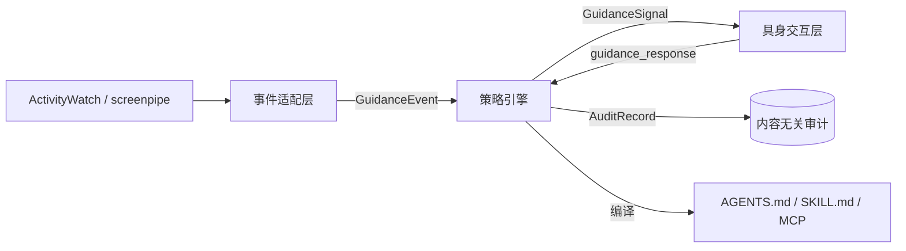

# guidance-runtime

把「AI 什么时候可以介入我的电脑操作」写成可执行、可审计、可跨 Agent 复用的策略。

一条策略源，编译成三种形态：`AGENTS.md` 片段、`SKILL.md` 技能、`MCP Server` 工具。宠物/悬浮层只负责把引擎产出的 `GuidanceSignal` 呈现给用户，从不亲自操作系统。



## 它不是什么

- 不是捕获器（不重造 ActivityWatch / screenpipe）
- 不是记忆数据库（不重造 Mem0 / Letta / Zep）
- 不是自动化执行器：MVP 没有 `autonomous` 级别，最高只到「需要用户批准」

## 60 秒上手

```bash
git clone https://github.com/hackmagic/guidance-runtime
cd guidance-runtime
npm ci
npm run build
```

校验内置策略包并查看决策：

```bash
node dist/cli.js validate packs/deep-work
node dist/cli.js list --policy packs/deep-work
node dist/cli.js evaluate --policy packs/deep-work \
  --event examples/focus-event.json \
  --now 2026-11-20T01:00:00Z --timezone Asia/Shanghai
```

输出（截断）：

```json
{
  "decision": "require_approval",
  "matched_policy_id": "morning-focus-protection",
  "signal": {
    "decision": "require_approval",
    "presentation": { "animation_hint": "alert", "bubble_text": "进入 50 分钟专注？" },
    "expires_at": "2026-11-20T01:50:00.000Z"
  }
}
```

把同一份策略编译给不同 Agent：

```bash
node dist/cli.js compile --policy packs/deep-work --out out --target all
# out/AGENTS.md
# out/skills/guidance-<policy-id>/SKILL.md
# out/mcp.json + out/guidance-policies/*.yaml
```

启动 MCP server（无状态，每个请求自带事件）：

```bash
node dist/cli.js mcp --policy packs/deep-work --audit ./audit.jsonl
```

启动宠物桥（给任意呈现层对接）：

```bash
node dist/cli.js pet --policy packs/deep-work --audit ./audit.jsonl --port 3778
curl -s localhost:3778/healthz
curl -s -X POST localhost:3778/v1/events -H 'content-type: application/json' \
  -d @examples/pet-event.json
```

## 一条策略长什么样

`packs/deep-work/policies/morning-focus-protection.yaml`：

```yaml
policy:
  id: morning-focus-protection
  version: 1
  description: 工作日早上进入专注块时，先征得同意再静默非紧急通知
  priority: 80
  trigger:
    event: focus_block_started
    context:
      app: [code, cursor, terminal]
  conditions:
    all:
      - day_of_week: [mon, tue, wed, thu, fri]
      - time_window: "09:00-12:00"
  decision: require_approval
  action:
    type: suppress_notifications
    scope: [slack, mail, im]
    parameters:
      duration_minutes: 50
  safety:
    requires_approval: true
    reversible: true
    audit_level: full
```

五条语义规则（写在 [docs/03-policy-dsl.md](docs/03-policy-dsl.md)，由测试固定）：

1. `decision: suppress` + `requires_approval: true` 只能产出审批请求，**引擎不执行**
2. `requires_approval: false` 必须写明 `rationale`，并且不能 `audit_level: none`
3. 同一事件按 `priority` 降序求值，第一条非 `allow` 的策略终止求值
4. 任何策略求值出错 → 降级为 `allow`（不干预）并写审计
5. 连续 3 次 `dismiss` → 该策略静音，并建议用户修订

## 三个 Agent 工具

| 工具 | 输入 | 输出 |
| --- | --- | --- |
| `guidance/evaluate` | `{ event }` | `{ decision, signal, matched_policy_id, degraded, throttled }` |
| `guidance/list-policies` | `{}` | 策略摘要列表 |
| `guidance/audit-query` | `{ since?, policy_id?, limit? }` | 内容无关的审计记录 |

MCP 版本 `2026-07-28`，无状态核心：`server/discover` 自描述，不需要握手期 session。

## 审计边界

白名单九个字段，多一个都写不进去：

```
event_id policy_id decision signal_id user_response timestamp engine_version degraded reason
```

禁止：屏幕截图、完整窗口标题、剪贴板内容、按键序列。测试 `tests/contract.test.ts` 会尝试注入 `window_title` 并断言被丢弃。

## 目录结构

```
src/
  events/    事件适配层（ActivityWatch → GuidanceEvent）
  policy/    策略解析、条件求值、优先级、静音、语义校验
  signal/    GuidanceSignal 构建与不变量校验
  audit/     内容无关审计（内存 / JSONL）
  engine.ts  有状态门面：求值 + 速率闸 + 审计
  pet/       宠物桥（HTTP + 传输无关协议）
  mcp/       无状态 stdio MCP server
  compile/   策略 → AGENTS.md / SKILL.md / MCP bundle
schemas/     五个契约 JSON Schema（policy/event/signal/audit/pet-contract）
packs/       策略模板库（社区贡献入口）
docs/        规范文档 00–08
```

## 开发

```bash
npm run typecheck      # tsc --noEmit
npm run lint           # 三层架构单向依赖检查
npm test               # 65 个测试
npm run validate-specs # 49 项契约一致性检查
npm run build
npm run check          # 以上全部
```

## 设计取舍

- **策略是 YAML，不是代码**：非开发者也能贡献一条策略；贡献门槛决定社区规模。
- **引擎不执行动作**：只产出 signal。执行发生在适配器、且必须经过用户批准——这让「AI 引导」和「AI 监控」有了明确分界线。
- **文案不交给模型**：`bubble_text` 来自策略，可审计、可测试、可复现。
- **审计在默认路径上**：宁可多发一次审批请求，也不记录任何屏幕内容。

## License

MIT
