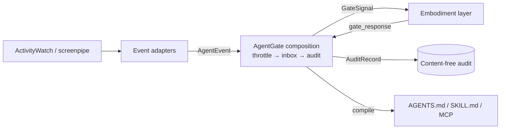

# AgentGate

English | [中文](README.zh.md)

**Write "when may AI act on my computer" as executable, auditable policy that survives a change of tool.**

Switch tools (Cursor → Claude Code → Codex) and you have to explain your boundaries all over again. AgentGate turns that boundary into one YAML file and compiles it into three shapes: an `AGENTS.md` section, `SKILL.md` skills, and an MCP server. One policy source, three agents reading the same rule — and CI proves it rather than claiming it.



The **gate** in the name is literal: the engine decides whether a door opens. It never pushes the door.

## What it is not

- Not a capture tool (it does not rebuild ActivityWatch / screenpipe)
- Not a memory database (it does not rebuild Mem0 / Letta / Zep)
- Not an automation executor: there is no `autonomous` level, the strongest decision only ever asks

## Sixty seconds

```bash
git clone https://github.com/hackmagic/AgentGate
cd AgentGate
npm ci
npm run build
```

Validate the bundled pack and watch one real decision:

```bash
node dist/cli.js validate packs/deep-work
node dist/cli.js list --policy packs/deep-work
node dist/cli.js evaluate --policy packs/deep-work \
  --event examples/focus-event.json \
  --now 2026-11-20T01:00:00Z --timezone Asia/Shanghai
```

Output, truncated:

```json
{
  "decision": "require_approval",
  "matched_policy_id": "morning-focus-protection",
  "signal": {
    "decision": "require_approval",
    "presentation": { "animation_hint": "alert", "bubble_text": "进入 50 分钟专注？" },
    "expires_at": "2026-11-20T01:50:00.000Z"
  }
}
```

Compile the same policies for different agents, then check the three artifacts agree:

```bash
node dist/cli.js compile --policy packs/deep-work --out out --target all
node dist/cli.js verify  --policy packs/deep-work
# out/AGENTS.md
# out/skills/agent-gate-<policy-id>/SKILL.md
# out/mcp.json + out/agent-gate-policies/*.yaml
```

Start the MCP server (stateless: every request carries its own event):

```bash
node dist/cli.js mcp --policy packs/deep-work --audit ./audit.jsonl
```

Start the embodiment bridge (for any presentation layer):

```bash
node dist/cli.js pet --policy packs/deep-work --audit ./audit.jsonl --port 3778
curl -s localhost:3778/healthz
curl -s -X POST localhost:3778/v1/events -H 'content-type: application/json' \
  -d @examples/pet-event.json
```

Ask what state a policy is in right now:

```bash
node dist/cli.js lifecycle --policy packs/deep-work --audit ./audit.jsonl
# [{ "policy_id": "morning-focus-protection", "state": "active", "consecutive_dismissals": 1, ... }]
```

## What a policy looks like

`packs/deep-work/policies/morning-focus-protection.yaml`:

```yaml
policy:
  id: morning-focus-protection
  version: 1
  description: 工作日早上进入专注块时，先征得同意再静默非紧急通知
  priority: 80
  trigger:
    event: focus_block_started
    context:
      app: [code, cursor, terminal]
  conditions:
    all:
      - day_of_week: [mon, tue, wed, thu, fri]
      - time_window: "09:00-12:00"
  decision: require_approval
  action:
    type: suppress_notifications
    scope: [slack, mail, im]
    parameters:
      duration_minutes: 50
  safety:
    requires_approval: true
    reversible: true
    audit_level: full
```

Five semantic rules, specified in [docs/04-policy-dsl.md](docs/04-policy-dsl.md) and pinned by tests:

1. `decision: suppress` with `requires_approval: true` may only produce an approval request — **the engine does not execute**
2. `requires_approval: false` must state a `rationale`, and must not use `audit_level: none`
3. Policies are evaluated by descending `priority`; the first non-`allow` decision ends evaluation
4. Any evaluation error degrades to `allow` (do not intervene) and is audited
5. Three consecutive `dismiss` responses mute the policy and suggest a revision

## Three agent tools

| Tool | Input | Output |
| --- | --- | --- |
| `gate/evaluate` | `{ event }` | `{ decision, signal, matched_policy_id, degraded, throttled }` |
| `gate/list-policies` | `{}` | Policy summaries |
| `gate/audit-query` | `{ since?, policy_id?, limit? }` | Content-free audit records |

MCP revision `2026-07-28`, stateless core: `server/discover` is self-describing, no handshake session.

## Three things most projects get wrong

This is what separates the project from a pile of `if` statements.

**1. The composition layer is a replaceable middleware chain, not a façade.**
Evaluation is a pure function; the rate limiter, the in-flight queue and the audit sink are three independent stages that run in registration order. `gate.pipeline` exposes that order and `stages: [...]` swaps the whole chain. See [docs/02-architecture.md](docs/02-architecture.md).

**2. Policies have a lifecycle, projected from the audit log.**
`draft → validated → active ⇄ muted → archived`. There is no second state file to drift from behaviour; given the audit log and a `now`, you can reconstruct the state at any past instant. See [docs/03-policy-lifecycle.md](docs/03-policy-lifecycle.md).

**3. Compile consistency is an executable check, not a promise.**
`source_hash` only proves the three artifacts came from the same input. `gate verify` also reads the artifacts **back as text** and compares decision, approval stance and copy field by field. A renderer that drops a field passes the hash check and fails this one. See [docs/06-compiler-spec.md](docs/06-compiler-spec.md).

## Audit boundary

A whitelist of nine fields. Not one more can get in:

```
event_id policy_id decision signal_id user_response timestamp engine_version degraded reason
```

Forbidden: screenshots, full window titles, clipboard contents, keystrokes. `tests/contract.test.ts` tries to inject `window_title` and asserts it is dropped.

## Layout

```
src/
  events/    Event adapters (ActivityWatch → AgentEvent)
  policy/    Parsing, condition evaluation, priority, mute, lifecycle, semantic validation
  signal/    GateSignal construction and invariant checks
  audit/     Content-free audit (memory / JSONL)
  gate/      Composition: pipeline + throttle + inbox + audit-stage
  pet/       Pet bridge (HTTP + transport-agnostic protocol)
  mcp/       Stateless stdio MCP server
  compile/   Policy → AGENTS.md / SKILL.md / MCP bundle, with parity verification
schemas/     Five contract JSON Schemas (policy/event/signal/audit/pet-contract)
packs/       Policy template library (the community contribution surface)
docs/        Specifications 00–09; index in docs/README.md
```

## Development

```bash
npm run typecheck      # tsc --noEmit
npm run lint           # four-layer dependency check + pure-core clock ban
npm test               # unit and contract tests
npm run validate-specs # code constants ↔ schema enums, plus doc facts
npm run build
npm run check          # all of the above
```

## Design trade-offs

- **Policies are YAML, not code**: non-developers can contribute one; the contribution threshold decides community size.
- **The engine executes nothing**: it only produces a signal. Execution happens in an adapter, after user approval — that is the line between "AI guidance" and "AI monitoring".
- **Copy is never generated**: `bubble_text` comes from the policy, so it is auditable, testable and reproducible.
- **Auditing is on the default path**: better to ask one extra time than to record any screen content.
- **Errors favour allowing**: intervene less rather than block wrongly.

## License

MIT
