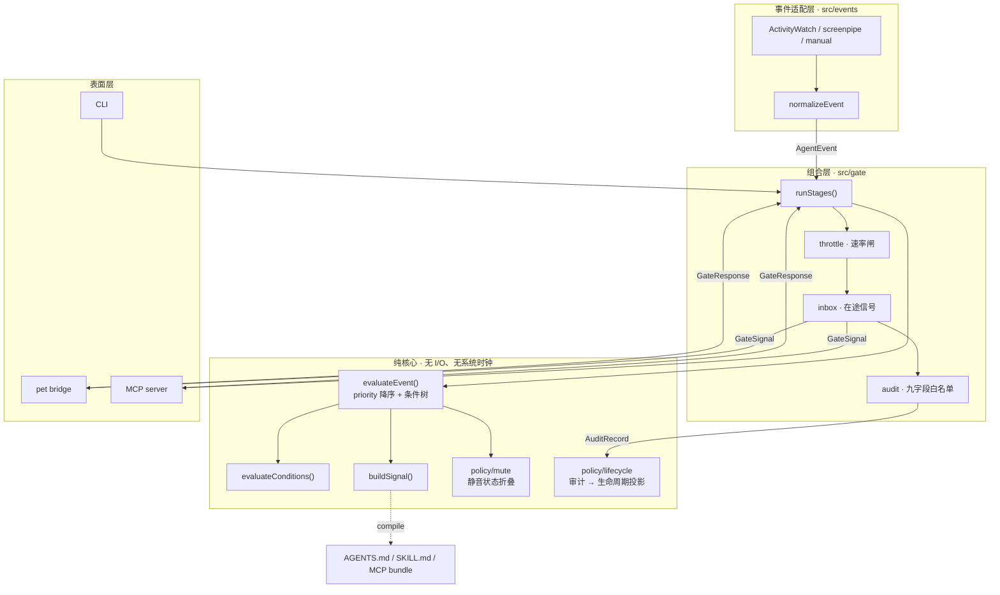

# 02 · 运行时架构

[English](02-architecture.md) | 中文

> 本文件回答一个问题：**系统怎么跑**。策略语义见 [04-policy-dsl](04-policy-dsl.zh.md) 与
> [03-policy-lifecycle](03-policy-lifecycle.zh.md)；编译产物见 [06-compiler-spec](06-compiler-spec.zh.md)。

## 一次求值的完整路径



## 四层，严格单向依赖

| 层 | 目录 | 职责 | 允许依赖 |
| --- | --- | --- | --- |
| 事件适配层 | `src/events/` | 只做格式转换与字段补齐 | `schema`、`util`、`errors` |
| 纯核心 | `src/policy/`、`src/signal/`、`src/audit/` | 决策：解析、求值、信号、静音、生命周期、审计存储 | 事件类型、`schema`、`util` |
| 组合层 | `src/gate/` | 编排：中间件链、在途信号、审计写入 | 纯核心 |
| 表面层 | `src/pet/`、`src/mcp/`、`src/compile/`、`src/cli.ts` | 呈现与编译 | 组合层 |

下层不知道上层的存在。这条约束由 `scripts/check-boundaries.mjs` 在 CI 中强制，
不是靠 review 时的人工记忆。

## 组合层：中间件链，不是门面

早期版本把求值、速率闸、审计塞进一个 `engine.ts` 门面。那是 MVP 阶段可以接受的
耦合，但它让三件事无法分别测试，也让「为什么这次没弹气泡」必须靠调试器回答。

现在 `src/gate/` 把它拆成四个可替换部件：

```ts
// src/gate/gate.ts —— 默认链条
this.stages = options.stages ?? [
  throttleStage(this.throttle, { presentation_window_minutes }),
  inboxStage(this.inbox),
  auditStage({ store: this.auditStore, engine_version }),
];
```

| 部件 | 文件 | 单一职责 |
| --- | --- | --- |
| `runStages()` | `pipeline.ts` | 按注册顺序跑 `before` → 纯求值 → `after` |
| `throttleStage()` | `throttle.ts` | 同一策略在呈现窗口内降级为 `allow` |
| `inboxStage()` | `inbox.ts` | 把存活信号放进在途队列 |
| `auditStage()` | `audit-stage.ts` | 观察**最终**状态并写一行审计 |

**注册顺序即语义。** throttle 在 inbox 之前，所以被限流的匹配不会进队列；audit
在最后，所以它记录的是降级后的结果（`rate_limited`），而不是原始的 `matched`。

`AgentGate` 自身不再持有决策逻辑。它的 `evaluate()` 只做三件事：构造调用对象、
跑链条、把「已呈现」写回 throttle 与静音状态。

```ts
const gate = new AgentGate({ policies, audit, timezone });
gate.pipeline; // ['throttle', 'inbox', 'audit'] —— 链条可被外部观测
```

替换整条链（例如回放历史数据时不想要速率闸）：

```ts
const replay = new AgentGate({ policies, audit, stages: [auditStage({ store, engine_version: '0.1.0' })] });
```

## 关键架构约束

违反任一条，PR 拒绝（`npm run lint` 会先拒一次）：

1. **引擎不得直接调用系统 API 执行拦截/抑制。** 它只产出 `GateSignal`，由适配器在用户批准后执行。
2. **事件适配层不得包含任何策略逻辑。** `src/events/` 不 import `policy/`、`signal/`、`gate/`。
3. **表面层不得绕过组合层直接监听原始事件。** 宠物只接收信号。
4. **审计日志不得包含原始屏幕内容或完整窗口标题。** 只记录九个白名单字段。
5. **纯核心不动 I/O、不读系统时钟。** 时钟由调用方注入；`policy/`、`signal/`、`events/normalize` 都是值进值出。
6. **只有组合层与适配器可以构造 `AgentGate`。** 纯核心不认识它。

第 5 条的一个细节：`randomUUID()` 允许作为**可覆盖的默认值**存在，但每个使用它的
纯模块必须同时暴露工厂参数（`idFactory` / `signal_id_factory`），否则测试无法复现。

## 数据流：一次事件

```
AgentEvent
   │ gate.evaluate(event, now)
   ▼
┌─ pipeline ────────────────────────────────────────┐
│  before: （默认链条没有 before 钩子）             │
│  evaluateEvent()  ← 纯函数，priority 降序         │
│  after:  throttle → inbox → audit                 │
└───────────────────────────────────────────────────┘
   │
   ├─ allow      → 无信号；仅在 degraded 时写审计
   ├─ throttled  → 降级 allow + 审计 reason=rate_limited
   └─ signal     → 进 inbox、写审计 reason=matched、返回给适配器
                        │
                        ▼
              GateSignal → 宠物 / MCP 呈现
                        │
                        ▼
              GateResponse（approve / dismiss / mute_1h）
                        │
                        ▼
              applyResponse() → 静音状态 + 审计 reason=user_*
```

## 技术选型

| 选择 | 理由 |
| --- | --- |
| TypeScript（ESM, strict） | 与 MCP 生态一致；类型即契约 |
| 单包、零运行时依赖（仅 `yaml`） | 安装体积小，供应链面窄 |
| 手写 JSON Schema 子集校验器 | 规则可审计，不引入 ajv 的隐式行为 |
| 纯函数求值 + 注入时钟 | 决策可复现，测试无需 mock 时间 |
| 中间件链而非门面 | 每一环可单独替换、单独测试；顺序显式 |
| 内存 / JSONL 审计 | MVP 不需要数据库；JSONL 可直接 grep |

## 为什么不把执行放进引擎

如果引擎能「直接执行」，那么每一个策略解析 bug 都会变成一次真实的系统变更。
把执行推到适配器，并强制 `requires_approval`，意味着最坏情况只是「多问了一次用户」。

这是「AI 引导」与「AI 监控」的分界线，也是架构第一约束。

## 什么情况下可以打破分层

只有一个方向允许破例：**表面层可以只读地访问纯核心的纯函数**（例如 CLI 直接调用
`projectLifecycle()` 打印状态），因为那是无副作用的计算，不引入新的依赖方向。

反向破例——纯核心 import 组合层或表面层——永远不允许。需要这类能力时，把数据作为
参数传进来，而不是把依赖拉下去。
