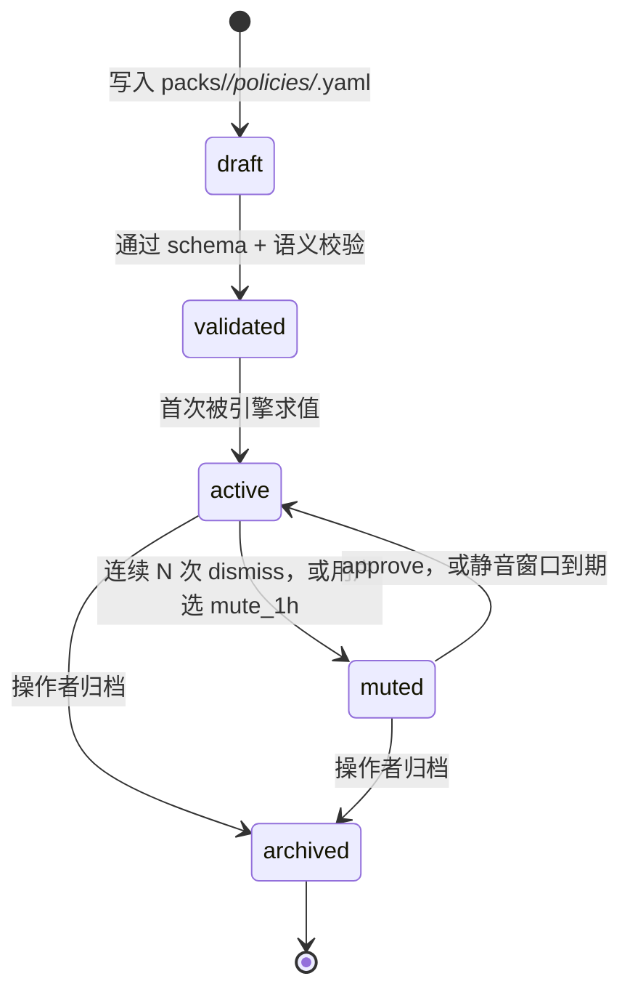

# 03 · 策略生命周期

> 本文件回答一个问题：**一条策略从写到死，经历什么**。
> 语义规则见 [04-policy-dsl](04-policy-dsl.md)；编译产物见 [06-compiler-spec](06-compiler-spec.md)。

策略引擎和普通规则引擎的区别不在「能不能匹配」，而在**匹配之后用户能不能反悔**。
这条链路的每一环都必须可观测，否则社区不敢贡献策略——没人愿意提交一条自己看不见
后果、也关不掉的规则。

## 状态机



| 状态 | 含义 | 谁决定 |
| --- | --- | --- |
| `draft` | 文件存在，但校验不通过 | 校验器（`validatePolicyDocument`） |
| `validated` | 合法，但从未被求值 | 校验器 |
| `active` | 引擎正在使用它 | 第一条审计记录 |
| `muted` | 用户让它闭嘴 | 用户回执 |
| `archived` | 退役，但保留历史 | 操作者，且必须写原因 |

## 状态从哪来：审计是唯一事实来源

不维护第二份状态文件。引擎唯一持久化的东西是审计日志，所以生命周期是它的**投影**：

```ts
projectLifecycle(policies, auditRecords, now, { archives })
```

这条设计的两点好处：

1. **不会漂移**：状态文件可以和实际行为不一致，投影不会；
2. **可回放**：给定同一份审计日志与 `now`，任何时刻都能重建当时的状态。

没有审计历史的策略报告为 `validated`，**绝不猜成 `active`**：没被求值过就是没被求值过。

### 投影规则

| 审计 `reason` | 对生命周期的影响 |
| --- | --- |
| `matched` / `degraded` / `rate_limited` | → `active`（引擎确实加载并求值了它） |
| `user_approved` | → `active`，dismiss 计数归零，清掉静音窗口 |
| `user_dismissed` | 计数 +1；状态不变 |
| `user_muted`（`mute_1h`） | → `muted`，开一个 60 分钟窗口；**不改计数** |
| `muted`（阈值静音） | → `muted`，无到期时间 |

`user_muted` 不改计数这条容易写错，所以它是 [04-policy-dsl](04-policy-dsl.md) 规则 5 的一部分，
由 `tests/lifecycle.test.ts` 固定。

## 静音的两种形态

同一个「闭嘴」动作有两种语义，混淆它们会让用户困惑：

| 形态 | 触发 | 到期 | 计数 |
| --- | --- | --- | --- |
| 有界静音 | 用户点 `mute_1h` | 60 分钟后由时钟自动解除 | 不变 |
| 无界静音 | 连续 3 次 `dismiss` | 只有 `approve` 或显式解除 | 重置为 0 |

有界静音的到期**不需要新审计记录**：`projectLifecycle` 把 `now` 与 `muted_until` 一比，
就地把状态折回 `active`，并追加一条 `mute_window_elapsed` 转换。这样「为什么它自己
恢复了」也有据可查。

## 归档

归档是**操作者行为**，不是推断出来的。它是 `ProjectLifecycleOptions.archives` 的显式输入：

```ts
projectLifecycle(policies, records, now, {
  archives: [{ policy_id: 'focus-guard', reason: 'superseded', at: '2026-11-20T09:00:00Z' }],
});
```

| `reason` | 何时用 |
| --- | --- |
| `superseded` | 被另一条策略取代 |
| `retired` | 场景不再需要 |
| `experimental` | 试验失败，撤下 |
| `revised` | 拆成了更细的几条 |

归档优先于任何运行时状态：即使当时正处于 `muted`，归档后也报告为 `archived`。

## 可观测性

```bash
gate lifecycle --policy packs/deep-work --audit ./audit.jsonl --now 2026-11-20T05:00:00Z
```

```json
[
  { "policy_id": "morning-focus-protection", "state": "active", "since": "2026-11-20T01:00:00.000Z", "consecutive_dismissals": 1, "muted_until": null }
]
```

`transitions` 保留完整转换序列，`tests/lifecycle.test.ts` 逐条断言它——因为
「这条策略为什么现在是 muted」的答案必须是数据，不能是调试会话。

## 贡献一条策略时要知道的四件事

1. **默认保守**：能 `require_approval` 就不要 `suppress`；
2. **能拒绝**：`require_approval` 的信号至少含一个非 `approve` 动作，否则用户没有出口；
3. **会静音**：连续 3 次否决后这条策略自己闭嘴，并建议你改条件——被静音不是 bug，是反馈；
4. **可归档**：任何策略都能被操作者退役，历史审计不受影响。

模板与评审标准见 [CONTRIBUTING.md](../CONTRIBUTING.md)。
