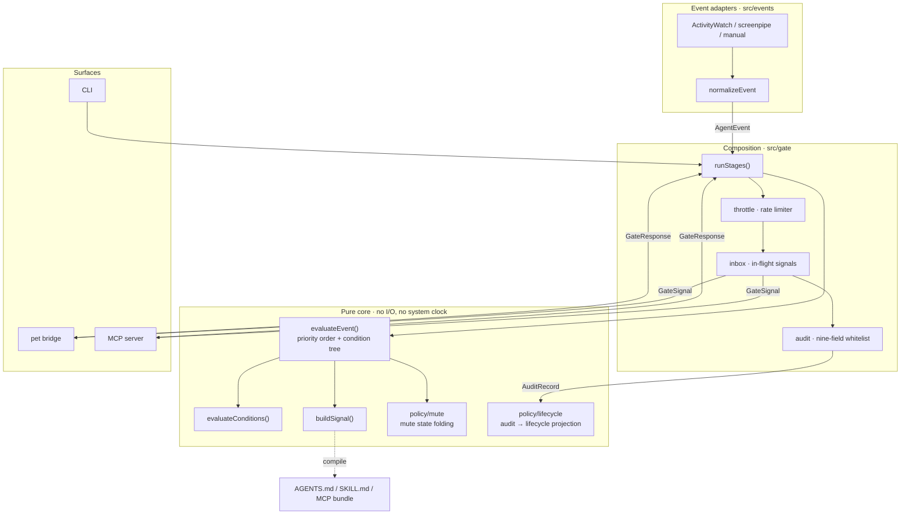

# 02 · Runtime architecture

English | [中文](../zh-cn/02-architecture.md)

> This document answers one question: **how does the system run**. Policy semantics live in
> [04-policy-dsl](04-policy-dsl.md) and [03-policy-lifecycle](03-policy-lifecycle.md); compiled
> artifacts live in [06-compiler-spec](06-compiler-spec.md).

## The full path of one evaluation



## Four layers, strictly one-directional

| Layer | Directory | Responsibility | May depend on |
| --- | --- | --- | --- |
| Event adapters | `src/events/` | Format conversion and field defaults only | `schema`, `util`, `errors` |
| Pure core | `src/policy/`, `src/signal/`, `src/audit/` | Decisions: parsing, evaluation, signals, mute, lifecycle, audit storage | Event types, `schema`, `util` |
| Composition | `src/gate/` | Orchestration: middleware chain, in-flight signals, audit writes | Pure core |
| Surfaces | `src/pet/`, `src/mcp/`, `src/compile/`, `src/cli.ts` | Presentation and compilation | Composition |

A lower layer never knows an upper one exists. `scripts/check-boundaries.mjs` enforces this in CI,
so it does not depend on anyone remembering during review.

## The composition layer: a middleware chain, not a façade

An earlier version welded evaluation, throttling and auditing into a single `engine.ts` façade.
That is acceptable for an MVP and it is the hardest thing to pull apart later: it makes three
capabilities untestable in isolation, and it turns "why did no bubble appear?" into a debugger
session.

`src/gate/` splits it into four replaceable parts:

```ts
// src/gate/gate.ts — the default chain
this.stages = options.stages ?? [
  throttleStage(this.throttle, { presentation_window_minutes }),
  inboxStage(this.inbox),
  auditStage({ store: this.auditStore, engine_version }),
];
```

| Part | File | Single responsibility |
| --- | --- | --- |
| `runStages()` | `pipeline.ts` | Run `before` → pure evaluation → `after`, in registration order |
| `throttleStage()` | `throttle.ts` | Downgrade a match to `allow` inside the presentation window |
| `inboxStage()` | `inbox.ts` | Put a surviving signal into the in-flight queue |
| `auditStage()` | `audit-stage.ts` | Observe the **final** state and write one audit line |

**Registration order is semantics.** Throttle runs before the inbox, so a rate-limited match never
queues. Audit runs last, so it records the downgraded outcome (`rate_limited`) rather than the raw
`matched`.

`AgentGate` itself holds no decision logic. Its `evaluate()` does three things: build the call
object, run the chain, and write "presented" back into throttle and mute state.

```ts
const gate = new AgentGate({ policies, audit, timezone });
gate.pipeline; // ['throttle', 'inbox', 'audit'] — the chain is observable
```

Replacing the whole chain, for example a replay harness that wants no rate limiting:

```ts
const replay = new AgentGate({ policies, audit, stages: [auditStage({ store, engine_version: '0.2.0' })] });
```

## Architecture constraints

Violating any of these rejects the pull request (`npm run lint` rejects it first):

1. **The engine must not call system APIs to block or suppress anything.** It produces a `GateSignal`; an adapter executes, after user approval.
2. **The event adapter layer must contain no policy logic.** `src/events/` does not import `policy/`, `signal/` or `gate/`.
3. **Surfaces must not bypass the composition layer to watch raw events.** The pet only receives signals.
4. **The audit log must not contain screen content or full window titles.** Nine whitelisted fields, nothing else.
5. **The pure core performs no I/O and reads no system clock.** The clock is injected; `policy/`, `signal/` and `events/normalize` are value-in, value-out.
6. **Only the composition layer and adapters may construct an `AgentGate`.** The pure core does not know it exists.

One detail on rule 5: `randomUUID()` may remain as an **overridable default**, but every pure module
that uses it must also expose a factory option (`idFactory` / `signal_id_factory`). Without it, tests
cannot reproduce a decision.

## Data flow: one event

```text
AgentEvent
   │ gate.evaluate(event, now)
   ▼
┌─ pipeline ─────────────────────────────────────────┐
│  before: (the default chain has no before hooks)    │
│  evaluateEvent()  ← pure, descending priority       │
│  after:  throttle → inbox → audit                  │
└─────────────────────────────────────────────────────┘
   │
   ├─ allow      → no signal; audited only when degraded
   ├─ throttled  → downgraded to allow, audit reason=rate_limited
   └─ signal     → enters the inbox, audit reason=matched, returned to the adapter
                        │
                        ▼
              GateSignal → pet / MCP presentation
                        │
                        ▼
              GateResponse (approve / dismiss / mute_1h)
                        │
                        ▼
              applyResponse() → mute state + audit reason=user_*
```

## Technology choices

| Choice | Reason |
| --- | --- |
| TypeScript (ESM, strict) | Matches the MCP ecosystem; types are the contract |
| Single package, no runtime dependency except `yaml` | Small install, narrow supply-chain surface |
| Hand-written JSON Schema subset validator | Reviewable rules, no implicit ajv behaviour |
| Pure evaluation plus an injected clock | Reproducible decisions; tests need no time mocking |
| A middleware chain rather than a façade | Each part is replaceable and testable; order is explicit |
| Memory / JSONL audit | An MVP needs no database; JSONL greps directly |

## Why execution does not live in the engine

If the engine could execute, every policy-parsing bug would become a real change to the user's
machine. Pushing execution into the adapter, and requiring `requires_approval`, means the worst case
is one extra question.

That is the line between "AI guidance" and "AI monitoring", and it is architecture constraint number one.

## When it is legitimate to break the layering

Exactly one direction may break: **a surface may read pure functions of the pure core** — for
example, the CLI calling `projectLifecycle()` directly to print state. That is side-effect-free
computation and introduces no new dependency direction.

The reverse — the pure core importing the composition layer or a surface — is never allowed. When
such a need appears, pass the data in as an argument instead of pulling the dependency down.
