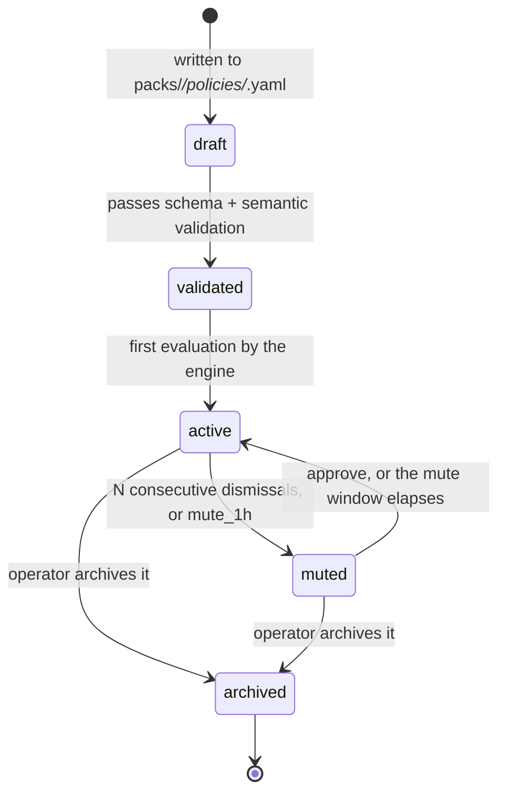

# 03 · Policy lifecycle

English | [中文](../zh-cn/03-policy-lifecycle.md)

> This document answers one question: **what happens to a policy from first write to retirement**.
> Semantic rules live in [04-policy-dsl](04-policy-dsl.md); compiled artifacts live in
> [06-compiler-spec](06-compiler-spec.md).

A policy engine differs from a plain rules engine not in whether it can match, but in whether the
user can **take it back** afterwards. Every link in that chain has to be observable, or nobody will
contribute a policy: no one wants to submit a rule whose consequences they cannot see and cannot
switch off.

## The state machine



| State | Meaning | Decided by |
| --- | --- | --- |
| `draft` | The file exists but does not validate | The validator (`validatePolicyDocument`) |
| `validated` | Legal, but never evaluated | The validator |
| `active` | The engine is using it | The first audit record |
| `muted` | The user silenced it | A user response |
| `archived` | Retired, history retained | An operator, with a mandatory reason |

## Where state comes from: the audit log is the only source of truth

There is no second state file. The only thing the engine persists is the audit log, so lifecycle is a
**projection** of it:

```ts
projectLifecycle(policies, auditRecords, now, { archives })
```

Two consequences, both deliberate:

1. **It cannot drift.** A state file can disagree with actual behaviour; a projection cannot.
2. **It is replayable.** Given the same audit log and a `now`, you can reconstruct the state at any
   past instant.

A policy with no audit history is reported as `validated`, **never guessed as `active`**: if it was
never evaluated, it was never evaluated.

### Projection rules

| Audit `reason` | Effect on lifecycle |
| --- | --- |
| `matched` / `degraded` / `rate_limited` | → `active` (the engine really did load and evaluate it) |
| `user_approved` | → `active`, dismissal count resets, mute window cleared |
| `user_dismissed` | Count +1; state unchanged |
| `user_muted` (`mute_1h`) | → `muted`, opens a 60-minute window; **does not change the count** |
| `muted` (threshold mute) | → `muted`, no expiry |

`user_muted` not changing the count is easy to get wrong, so it is part of rule 5 in
[04-policy-dsl](04-policy-dsl.md) and is pinned by `tests/lifecycle.test.ts`.

## Two shapes of "be quiet"

The same "silence it" gesture has two semantics; conflating them confuses users:

| Shape | Trigger | Expiry | Count |
| --- | --- | --- | --- |
| Bounded mute | User picks `mute_1h` | Lifted by the clock after 60 minutes | Unchanged |
| Unbounded mute | Three consecutive `dismiss` | Only `approve` or an explicit unmute | Reset to 0 |

A bounded mute expiring **needs no new audit record**: `projectLifecycle` compares `now` against
`muted_until`, folds the state back to `active`, and appends a `mute_window_elapsed` transition. So
"why did it come back by itself?" also has a written answer.

## Archiving

Archiving is an **operator action**, never inferred. It is explicit input to
`ProjectLifecycleOptions.archives`:

```ts
projectLifecycle(policies, records, now, {
  archives: [{ policy_id: 'focus-guard', reason: 'superseded', at: '2026-11-20T09:00:00Z' }],
});
```

| `reason` | When to use it |
| --- | --- |
| `superseded` | Another policy replaced it |
| `retired` | The situation no longer applies |
| `experimental` | An experiment failed; withdraw it |
| `revised` | Split into several finer policies |

Archiving outranks any runtime state: even a policy that was `muted` reports `archived` afterwards.

## Observability

```bash
gate lifecycle --policy packs/deep-work --audit ./audit.jsonl --now 2026-11-20T05:00:00Z
```

```json
[
  { "policy_id": "morning-focus-protection", "state": "active", "since": "2026-11-20T01:00:00.000Z", "consecutive_dismissals": 1, "muted_until": null }
]
```

`transitions` keeps the whole sequence, and `tests/lifecycle.test.ts` asserts it line by line —
because the answer to "why is this policy muted now" has to be data, not a debugging session.

## Four things to know before contributing a policy

1. **Be conservative by default**: prefer `require_approval` over `suppress`.
2. **Allow refusal**: a `require_approval` signal must offer at least one non-`approve` action, or the user has no exit.
3. **It will mute itself**: three consecutive rejections silence the policy and suggest changing the condition — being muted is feedback, not a bug.
4. **It can always be archived**: an operator can retire any policy, and the audit history is unaffected.

Templates and review criteria are in [CONTRIBUTING.md](../../CONTRIBUTING.md).
